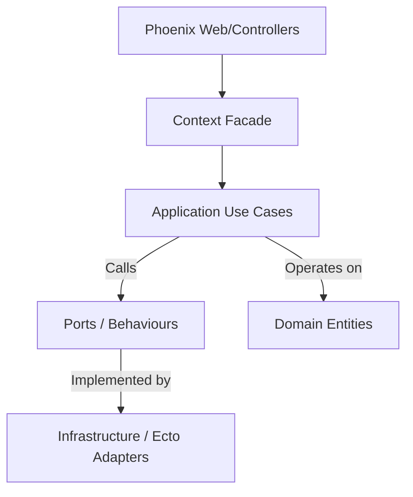

# HexaGen

**The Architecture Guardian for Phoenix: Build clean ecosystems, not spaghetti code.**

HexaGen is a standardized Hexagonal Architecture scaffolding tool that extends the default Phoenix generators. It enforces a strict separation of concerns using the Ports and Adapters pattern, ensuring your business logic remains pure and entirely decoupled from technical details like databases or external APIs.

## Why HexaGen?

Standard Phoenix contexts often grow organically, inevitably mixing Ecto logic, web presentation, and business rules into tightly coupled monoliths. HexaGen prevents this by enforcing a directory structure that follows SOLID principles out of the box.

More than just a generator, HexaGen is a strict architectural guardian. By automating infrastructure, tests, and monitoring—and strictly decoupling the domain from the web layer—HexaGen allows development teams to **save up to 40% of setup and refactoring time**, letting developers focus exclusively on what matters: the core business rules.

### The Architecture



## Features

- Domain Layer: Pure Elixir structs representing business entities.
- Application Layer: Isolated Use Cases (one module per action) and Ports (contracts).
- Infrastructure Layer: Technical implementations (Ecto adapters) that can be easily swapped.
- Dependency Injection: Dynamic adapter injection using Elixir configuration.
- Built-in Mocking: Pre-configured setup for Mox for fast unit tests.
- High Code Coverage: Extensively tested for reliability.
- One Core, Multiple Skins: Write your business logic once and seamlessly generate API (JSON), traditional Web (HTML), or real-time (LiveView) interfaces on top of it without rewriting a single domain rule.
- Centralized Error Handler: Forget about mapping {:error, reason} in every controller. HexaGen includes an intelligent error handler that automatically translates domain errors into the correct HTTP status codes.
- Mox-Zero-Config TDD: Out-of-the-box native Dependency Injection. HexaGen automatically injects Mox definitions into your test_helper.exs, removing the friction of configuring mocks so you can test at high speed.
- CodeGraph Static Analysis: Concurrently scans your codebase, extracts explicit module dependencies via Elixir's AST, and indexes the entire architecture in a local SQLite database for instant visualization.

## Getting Started

### 1. Installation

Add hexagen to your mix.exs:

```elixir
def deps do
  [
    {:hexagen, "~> 0.1.4", only: :dev}
  ]
end
```

### 2. Setup

Run the setup task to prepare the project folders:

```bash
mix hexagen.setup
```

### 3. Generate a Hexagonal Context

```bash
mix hexagen.gen.context Accounts User users name:string age:integer
```

### 4. Generate Web Layers

```bash
mix hexagen.gen.html Accounts User users name:string
mix hexagen.gen.json Accounts User users name:string
mix hexagen.gen.live Accounts User users name:string
```

### 5. Index Module Dependencies (CodeGraph)

To run the static analysis on your project and generate an Ecto-backed local SQLite architecture database:

```bash
mix hexagen.codegraph -i
```

This bootstraps a dynamic SQLite database (`codegraph.db`) in the root directory and indexes the architecture structure in optimized transactional batches.

---

## CodeGraph Static Analysis

HexaGen includes a built-in static analysis engine called **CodeGraph**. It allows you to concurrently map explicit module dependencies (`alias`, `import`, `require`, and `use`) and persist the architectural structure into a local SQLite database. This creates a clean relational index of your system's architecture, ready to be consumed by interactive frontends (such as Cytoscape.js or D3.js).

### How It Works Under the Hood

1. **Concurrent AST Parsing:** Scans all `.ex` and `.exs` files recursively and parses their contents using Elixir's native `Code.string_to_quoted/2` within a `Task.async_stream` pipeline.
2. **MD5 File Hashing:** Calculates MD5 hashes for all scanned files to track content consistency and changes.
3. **Deep Module Resolution:** Resolves complex AST configurations, such as:
   - Nested module declarations (resolving child namespaces like `Parent.Child`).
   - Relative `__MODULE__` reference names.
   - Combined multi-alias declarations (e.g., `alias Prefix.{A, B}`).
4. **Relational Indexing:** Tracks internal defined modules, slices (vertical slices derived from namespaces), and also catalogs referenced external modules (e.g. `Logger`, `Phoenix.Controller`) as placeholder nodes to preserve absolute relational integrity in the graph.
5. **High-Speed Upserts:** Batches all nodes (modules) and edges (dependencies) in a single SQLite transaction with highly performant upserts (`on_conflict` parameters) to prevent locks and ensure maximum speed.

### SQLite Schema

The generated `codegraph.db` contains the following schema:

* **`modules`**: Representing vertices/nodes in your system.
  * `id` (integer primary key auto-increment)
  * `name` (string, unique module name)
  * `slice` (string, the vertical slice it belongs to)
  * `file_path` (string, physical file path; `NULL` for external modules)
  * `content_hash` (string, MD5 file contents hash; `NULL` for external modules)
* **`dependencies`**: Representing directed edges in your system.
  * `id` (integer primary key auto-increment)
  * `source_module_id` (integer, references `modules.id`)
  * `target_module_id` (integer, references `modules.id`)
  * `type` (string, type of dependency: `alias`, `import`, `require`, `use`)

## SOLID Compliance

- S: Single Responsibility - One module per Use Case.
- O: Open/Closed - Add new adapters without touching business logic.
- L: Liskov Substitution - Swap implementations via Behaviours.
- I: Interface Segregation - Clean Ports define exact requirements.
- D: Dependency Inversion - High-level logic depends on abstract Ports.

## Contributing

Contributions are welcome. If you have suggestions for improving the scaffolding or adding new adapters, please open an issue or pull request.
